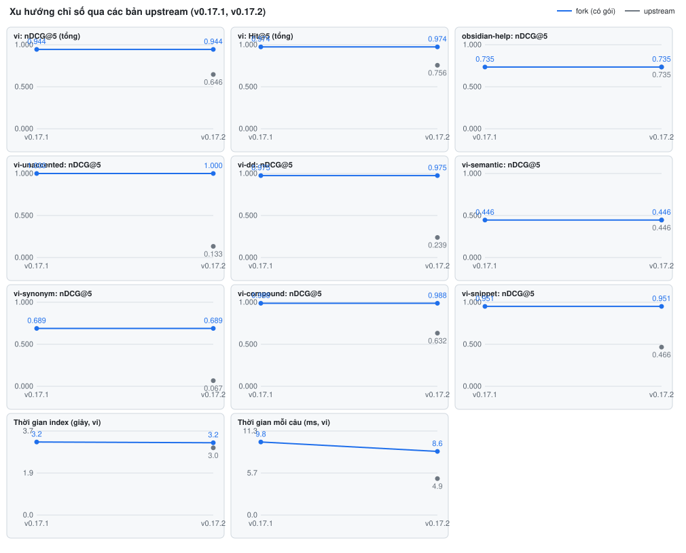

# Upstream v0.17.2 (so với fork v0.17.1)

Chạy bằng `vantt/scripts/review-upstream.mjs --tag v0.17.2 --prev v0.17.1` trên linux-x64, Node 24, một lần chạy duy nhất cho cả bốn cây (202 giây). Dữ liệu máy: `vantt/reviews/v0.17.2.data.json`.

- "Fork trước" là bản dựng `vantt/v0.17.1` (v0.17.1 cộng chuỗi 9 bản vá hiện tại), "fork mới" là `vantt/v0.17.2`. Gói ngôn ngữ là `ohs-lang-vi` của nhánh `vantt/work/vi-snippet-fix` (từ điển ghép có giấy phép, `restoreForEmbedding` bật), bộ eval `vi` là fixture `v0.11.0` (423 note, 270 câu).
- Cả bốn cây dựng sạch. Release fork mới nhất khi viết báo cáo là `v0.17.2-vantt.4` (4 gói); báo cáo này kiểm cây, không kiểm gói.
- Catchup đầy đủ (T1 đến T5, `--with-lang vi`) trên hai nhánh: T1 upstream, T2 test của cả 9 bản vá và T4 bất biến (58/58 câu giống hệt upstream) đều đạt; T3 `lang_vi` hỏng một test và catchup dừng ở `TESTS_FAILED` (thoát 5), nên T5 (cổng chất lượng) chưa chạy. Test hỏng giống nhau ở cả hai tag: `segment.test.ts` "ships with the package: npm pack includes the dictionary…". Nguyên nhân đã kiểm: catchup đặt npm 12 lên đầu `PATH`, và `npm pack --dry-run --json` của npm 12 trả một object khoá theo tên gói thay vì một mảng, nên test đọc `.files` của phần tử đầu bị `undefined` (npm 11 trả mảng). Lỗi nằm ở test của gói, không liên quan upstream và không đổi kết quả tìm.

## Tóm tắt
- Nên nâng bản fork lên v0.17.2: **có**. Upstream chỉ nâng phụ thuộc (một commit), cả chín bản vá áp sạch, chín probe đều xanh trên `vantt/v0.17.2`, fork bằng fork trước ở mọi hạng mục.
- Bản vá có thể bỏ: **không có**. Probe trên upstream v0.17.2 trả 1 (vấn đề còn) cho cả chín bản vá, giống v0.17.1.
- Rủi ro chính: thấp. Test đóng gói của gói `vi` hỏng dưới npm 12 (xem trên) cần sửa trước khi catchup đầy đủ xanh; thời gian mỗi câu của fork khoảng gấp đôi upstream khi bật gói (8,6 ms so với 4,9 ms).

## Thay đổi của upstream liên quan tới fork
- Phạm vi `v0.17.1..v0.17.2`: một commit, `201dd1f chore: update dependencies (#90)`; ba file (`package.json`, `package-lock.json`, `server.json`), 378 dòng thêm, 530 dòng bớt. CHANGELOG không đổi.
- `package.json`: `ignore` 7.0.12 lên 7.0.14, `unist-util-visit` 5.1.0 lên 5.2.0, `knip` 6.42.0 lên 6.43.0, cộng bản nâng trong lock.
- Không file nguồn nào đổi: không có thay đổi ở `searcher.ts`, `db.ts`, `search-queries.ts`, `chunker.ts`, `embedder.ts`, `config.ts` (các điểm gắn của gói ngôn ngữ, PRD 10.2) và không commit nào chạm `touches` của bản vá nào.
- Hệ quả: mọi khác biệt chất lượng đo được dưới đây đến từ bản vá và gói ngôn ngữ, không từ upstream.

## Bản vá
Probe chạy trên cây upstream nguyên gốc (0 = đã giải, 1 = còn, 2 = không kiểm được) và trên cả hai cây fork. Cả chín bản vá trong `series.toml` lúc chạy đều có kết quả probe ở cả bốn cây.

| id | Probe trên upstream | Áp được không | Đề xuất | Bằng chứng |
|---|---|---|---|---|
| fork-identity | 1 (v0.17.1 cũng 1) | áp sạch trên v0.17.2 và v0.17.1 | giữ | probe fork mới 0, fork trước 0; không commit nào đổi `touches` |
| language-pack-api | 1 (v0.17.1 cũng 1) | áp sạch cả hai | giữ | probe fork 0 cả hai; `searcher.ts`, `db.ts`, `config.ts` không đổi; gói `vi` nạp được (eval dưới) |
| db-path | 1 (cũng 1) | áp sạch cả hai | giữ | probe fork 0 cả hai |
| vector-export | 1 (cũng 1) | áp sạch cả hai | giữ | probe fork 0 cả hai |
| stdio-parity | 1 (cũng 1) | áp sạch cả hai | giữ | probe fork 0 cả hai |
| unicode-inline-tags | 1 (cũng 1) | áp sạch cả hai | giữ | probe fork 0 cả hai |
| block-anchors | 1 (cũng 1) | áp sạch cả hai | giữ | probe fork 0 cả hai; `chunker.ts`, `search-queries.ts` không đổi |
| restrict-paths | 1 (cũng 1) | áp sạch cả hai | giữ | probe fork 0 cả hai |
| index-events | 1 (cũng 1) | áp sạch cả hai | giữ | probe fork 0 cả hai |

Không bản vá nào đánh dấu `merged` trong `series.toml`; không có bằng chứng upstream đã tự giải bất kỳ vấn đề nào.

## Chất lượng tìm
Cùng máy, cùng lần chạy, eval của upstream (`eval/evaluate.ts`), k = 10, model `Xenova/multilingual-e5-small`, không rerank. Chênh = fork mới trừ upstream mới. Cột `vi` là nDCG@5 (Hit@5 trong ngoặc); các chỉ số khác (MRR, Hit@1, Recall@10) nằm trong file dữ liệu.

obsidian-help (171 note, 58 câu), nDCG@5. Không có gói, fork cho kết quả y hệt upstream:

| Bộ eval | Hạng mục | upstream mới | fork trước | fork mới | Chênh |
|---|---|---|---|---|---|
| obsidian-help | tất cả | 0,735 | 0,735 | 0,735 | 0 |
| obsidian-help | keyword | 0,849 | 0,849 | 0,849 | 0 |
| obsidian-help | conceptual | 0,448 | 0,448 | 0,448 | 0 |
| obsidian-help | multilingual | 0,413 | 0,413 | 0,413 | 0 |
| obsidian-help | syntax | 0,850 | 0,850 | 0,850 | 0 |

vi (423 note, 270 câu); fork có gói `ohs-lang-vi`. Fork mới chạy không gói có nDCG@5 tổng 0,646, bằng upstream mới:

| Bộ eval | Hạng mục | upstream mới | fork trước | fork mới | Chênh |
|---|---|---|---|---|---|
| vi | tất cả | 0,646 (0,76) | 0,944 (0,97) | 0,944 (0,97) | +0,298 |
| vi | vi-unaccented | 0,133 (0,27) | 1,000 (1,00) | 1,000 (1,00) | +0,867 |
| vi | vi-dd | 0,239 (0,40) | 0,975 (1,00) | 0,975 (1,00) | +0,736 |
| vi | vi-telex | 0,333 (0,47) | 1,000 (1,00) | 1,000 (1,00) | +0,667 |
| vi | vi-synonym | 0,067 (0,13) | 0,689 (0,93) | 0,689 (0,93) | +0,622 |
| vi | vi-snippet | 0,466 (0,60) | 0,951 (1,00) | 0,951 (1,00) | +0,485 |
| vi | vi-alias | 0,477 (0,67) | 0,959 (1,00) | 0,959 (1,00) | +0,482 |
| vi | vi-typo | 0,543 (0,80) | 1,000 (1,00) | 1,000 (1,00) | +0,457 |
| vi | vi-compound | 0,632 (0,90) | 0,988 (1,00) | 0,988 (1,00) | +0,356 |
| vi | vi-partial-accent | 0,863 (1,00) | 1,000 (1,00) | 1,000 (1,00) | +0,137 |
| vi | vi-names | 0,909 (0,93) | 1,000 (1,00) | 1,000 (1,00) | +0,091 |
| vi | vi-abbr | 0,933 (0,93) | 1,000 (1,00) | 1,000 (1,00) | +0,067 |
| vi | vi-tone-precision | 0,951 (1,00) | 1,000 (1,00) | 1,000 (1,00) | +0,049 |
| vi | vi-accented, vi-iy, vi-mixed-en, vi-tone-placement | 1,000 | 1,000 | 1,000 | 0 |
| vi | vi-semantic | 0,446 (0,60) | 0,446 (0,60) | 0,446 (0,60) | 0 |

- Cờ tự động (upstream hơn fork mới quá 0,02 nDCG@5, hoặc fork mới thấp hơn fork trước quá 0,02): **không có ô nào**. Fork mới bằng fork trước ở mọi hạng mục.
- `vi-semantic` không đổi so với upstream (gói không có thành phần ngữ nghĩa) và `vi-synonym` còn 0,689 nDCG@5: hai chỗ gói chưa đạt. Ghi nhận cho kế hoạch gói, không ảnh hưởng quyết định nâng bản.
- Thời gian (một lần chạy, một máy; chỉ đọc xu hướng): index vi 3,2 s fork so với 3,0 s upstream; mỗi câu 8,6 ms fork so với 4,9 ms upstream (không gói: 4,7 ms). Chi phí chủ yếu từ việc tạo nhiều view truy vấn của gói.

## So sánh định tính (mù)
Hai phía: `upstream@v0.17.2` và `fork@v0.17.2` (có gói `vi`). 20 câu tiếng Việt, mỗi hạng mục `vi-*` một câu trước (17 hạng mục, chọn ngẫu nhiên có seed 1, chỉ lấy câu mà top 5 hai phía khác nhau), rồi bù ba câu ngẫu nhiên; thứ tự A/B xáo trộn. Người chấm chỉ đọc tiêu đề và đoạn trích, không đọc khoá A/B, không xem chỉ số trước khi chấm. Đoạn trích là đoạn quanh từ khoá đầu tiên của câu hỏi trong vault `vi-search` sinh (nội dung công khai).

| Cặp so | Fork thắng | Hoà | Fork thua | Ghi chú |
|---|---|---|---|---|
| upstream v0.17.2 và fork v0.17.2 (20 câu) | 14 (rõ 6, hơi 8) | 5 | 1 | Thắng rõ ở câu không dấu, Telex, tên phố, từ ghép và alias (note đúng lên hạng 1 thay vì hạng 2 đến 5); hoà ở các câu đã có dấu hoặc hai danh sách gần như giống nhau; thua một câu (`sao lưu dữ liệu hằng tuần`, phần đuôi danh sách của fork lẫn một note không liên quan) |

Cách đọc: tín hiệu phụ, và chỉ nhìn tiêu đề với đoạn trích nên không thấy được hạng của note đúng như eval thấy. Lần này lấy câu trải đều các hạng mục nên ít lệch hơn lần chọn theo chênh lớn nhất; kết quả cùng chiều với chỉ số (fork +0,298 nDCG@5 tổng) nhưng nhỏ hơn mức chênh của chỉ số, vì nhiều hạng mục đã 1,000 ở cả hai phía. Không so `fork trước` với `fork mới` vì hai phía giống hệt nhau từng hạng mục. Lần chạy này chưa có bộ eval riêng (`--private`).

<!-- trends:start -->
## Xu hướng qua các bản

Điểm đo: v0.17.1, v0.17.2. Tạo tự động bởi `review-upstream.mjs` từ `vantt/reviews/*.data.json`; mỗi bản lấy lần review mới nhất. Số đo của các bản khác nhau lấy ở những lần chạy khác nhau (máy, tải khác nhau có thể làm thời gian lệch), nên chỉ đọc xu hướng, không đọc chênh nhỏ.
<!-- trends:end -->

## Việc cần người quyết
1. Chấp nhận nâng fork lên v0.17.2: đề xuất chấp nhận.
2. Sửa test đóng gói của gói `vi` (`segment.test.ts`, đọc kết quả `npm pack --json` của cả npm 11 lẫn npm 12) để catchup đầy đủ qua T3 và chạy tới cổng chất lượng T5; hiện cả `v0.17.1` và `v0.17.2` dừng ở đó.
3. Không đổi `upstream_status` của bản vá nào.
4. Có cần golden set riêng (`--private`, V15) cho lần review tới không; lần này không có.
